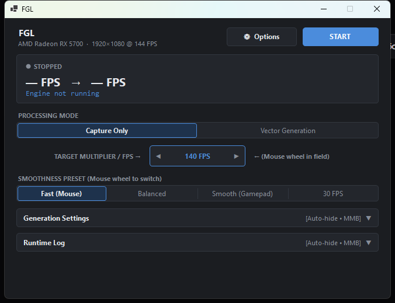

# FrameGenLive (FGL)

[](LICENSE)
[]()
[]()
[]()
[-brightgreen?style=for-the-badge&logo=windows)](https://github.com/TRickster228666/FGL/releases/latest)

> **Real-time Optical Flow Frame Generation Overlay for PC Games**  
> Boost perceived smoothness and double/triple frame rates up to 144, 165, 240, and 360 FPS with sub-millisecond GPU compute overhead. Works on **any** GPU (NVIDIA, AMD, Intel).

<p align="center">
  
</p>

---

## English

### Overview
**FrameGenLive (FGL)** is an open-source, high-performance real-time frame generator for Windows games. Using Direct3D 11 Compute Shaders and the Windows Desktop Duplication API, FGL captures your game's visual output, computes optical flow vectors across a hierarchical resolution pyramid, detects static UI elements and occlusions, and renders motion-interpolated frames directly to a zero-overhead transparent borderless overlay.

Unlike vendor-locked alternatives (DLSS 3 requiring RTX 40-series, AFMF requiring AMD) or paid proprietary tools, FrameGenLive is **100% free, open-source (MIT), and vendor-agnostic**.

### Key Features
- **Ultra-Fast GPU Execution**: Hierarchical motion vector search executes in **~0.53 ms**, and full-screen interpolation in **~0.13 ms** (total GPU time < 0.7 ms at 1080p).
- **Zero-Allocation Rendering**: Render loop operates without dynamic heap allocations, guaranteeing zero garbage collection pauses.
- **Pure Vector Warping (`--nofade`)**: No ghosting, double-vision, or blur on high-speed movements.
- **Static HUD & Crosshair Masking**: Prevents UI elements, health bars, and weapon sights from smearing or warping.
- **Adaptive Phase-Locked Pacer (PLL)**: Eliminates micro-stutter by smoothly matching output ticks to your target display FPS (60, 144, 165, 240, 360 FPS).
- **Multilingual Support**: English by default, with dynamic switching to Russian in the settings menu (⚙).
- **Standalone & Portable**: Self-contained x64 binary requiring zero external runtimes or SDKs.

---

### Smoothness Presets

| Preset | Target Usage & Conditions | Buffer Latency | Search Radius |
| :--- | :--- | :---: | :---: |
| **Fast (Mouse)** | First-person shooters and fast action games with mouse aim. Requires stable base 55–60 FPS. | ~20–22 ms | 14 px |
| **Balanced** | Universal profile for modern action/adventure titles. Optimal balance between stability and latency. | ~30 ms | 16 px |
| **Smooth (Gamepad)** | Gamepad-focused titles (racing, RPGs, sports) or games with irregular frametimes. Uses TSmooth. | ~36 ms | 18 px |
| **30 FPS Lock** | Dedicated frame multiplier for console emulators and 30-FPS locked game engines. | ~50 ms | 20 px |

---

### Quick Start Guide

1. **Configure Your Game**:
   - Set display mode to **Borderless Windowed** (or Windowed Fullscreen).
   - Disable **HDR** (Direct3D capture requires standard 8-bit SDR BGRA surface).
   - In graphics settings, cap your in-game framerate to a stable rate (e.g., 60 FPS or 72 FPS for a 144 FPS target).
2. **Launch FrameGenLive**:
   - Download the standalone zip from [Releases](https://github.com/TRickster228666/FGL/releases/latest).
   - Extract and run `FrameGenLiveApp.exe`.
   - Select your desired **Preset** and **Target FPS / Multiplier** (or leave on *Auto*).
   - Click **START** (a 3-second countdown will start — switch to your game window).
3. **Control Panel Hotkeys**:
   - **Middle Mouse Button (MMB)** on section drawers: Pins the drawer open so it does not auto-collapse.
   - **Mouse Wheel** inside the Multiplier box: Quickly adjust target FPS or multipliers.
   - **Right-Click** inside the Multiplier box: Choose from common target FPS presets (60, 120, 144, 165, 240, 360 FPS).

---

### Building from Source

Prerequisites: [.NET 8.0 SDK](https://dotnet.microsoft.com/download/dotnet/8.0).

```bash
# Clone the repository
git clone https://github.com/TRickster228666/FGL.git
cd FGL

# Build both Engine and UI
dotnet build src/FGMEngine/FrameGenLive.csproj -c Release
dotnet build src/FGLApp/FrameGenLiveApp.csproj -c Release
```

---

### CLI Reference (`FrameGenLive.exe`)

| Argument | Description | Default |
| :--- | :--- | :---: |
| `--mode <0\|1\|2>` | `0`: Passthrough capture, `1`: Vector interpolation, `2`: Frame blend | `1` |
| `--mult <N>` | Target frame multiplier (`0`: auto match display FPS, `1.5`, `2.0`, `3.0`) | `0` |
| `--hz <N>` | Force fixed target FPS (e.g., `144`, `240`) | `0` (auto) |
| `--delay <N>` | Target latency buffer depth in milliseconds (`0`: auto PLL dynamic buffer) | `0` (auto) |
| `--r0 <N>` | Block matching search window radius at base pyramid level | `16` |
| `--extrap <1.0..1.8>` | Motion vector forward extrapolation ceiling for drop tolerance | `1.5` |
| `--tsmooth <val>` | Temporal smoothing coefficient across frames (`0`: off, `0.15`: on) | `0.0` |
| `--nostatic` | Disable stationary HUD/crosshair classifier | Enabled |
| `--noocc` | Disable bidirectional occlusion consistency check (saves ~40% GPU time) | Enabled |
| `--nofade` | Pure vector warping without edge alpha-blending (avoids double vision) | Enabled |
| `--tearing` | Allow presentation tearing without waiting for VSync interval | Disabled |
| `--selfcheck` | Run synthetic automated vector and mask correctness checks | N/A |
| `--bench` | Run offline GPU micro-benchmarking on synthetic workloads | N/A |

---

<br/>

## Русский

### Описание
**FrameGenLive (FGL)** — это высокопроизводительный генератор промежуточных кадров в реальном времени для Windows. Используя вычислительные HLSL-шейдеры Direct3D 11 и API Windows Desktop Duplication, FGL захватывает изображение из запущенной игры, вычисляет векторы оптического потока по многоуровневой пирамиде разрешений, фильтрует статические элементы интерфейса (прицел, мини-карта) и выводит сгенерированные кадры в прозрачный аппаратный оверлей с минимальной задержкой.

В отличие от проприетарных технологий (DLSS 3 работает только на RTX 40, AFMF только на AMD) и платных программ, FrameGenLive **полностью бесплатен, открыт (MIT) и работает на любых видеокартах**.

### Основные возможности
- **Сверхбыстрый расчет на GPU**: Поиск векторов движения выполняется за **~0.53 мс**, а построение кадра — за **~0.13 мс** (суммарно менее 0.7 мс на 1080p).
- **Полное отсутствие пауз сборщика мусора**: Рендер-луп оптимизирован под нулевые аллокации в куче, исключая микрофризы и статтеры.
- **Чистый векторный варп (`--nofade`)**: Отсутствие двоения полупрозрачных контуров (ghosting) даже при резких поворотах камеры.
- **Маска статического интерфейса**: Прицел, шкалы здоровья и мини-карта остаются идеально четкими без артефактов движения.
- **Фазовый регулятор плавности (PLL Pacer)**: Устраняет микро-рывки, строго привязывая вывод кадров к целевому FPS (60, 144, 165, 240, 360 FPS).
- **Двуязычный интерфейс**: Английский по умолчанию, переключение на русский в один клик через меню шестеренки (⚙).
- **Автономная сборка**: Запускается «из коробки» на Windows 10/11 x64, не требуя установки .NET SDK или сторонних библиотек.

---

### Пресеты генерации

| Пресет | Сценарий применения и условия | Буфер | Радиус поиска |
| :--- | :--- | :---: | :---: |
| **Быстрый (Мышь)** | Динамичные шутеры от 1-го лица и экшены с прицеливанием мышью. Требуются стабильные 55–60 FPS. | ~20–22 мс | 14 px |
| **Баланс** | Универсальный режим для большинства игр. Оптимальное соотношение стабильности и задержки. | ~30 мс | 16 px |
| **Плавный (Геймпад)** | Игры на геймпаде (гонки, спорт, TPS) или игры с дерганым базовым фреймтаймом. Включен TSmooth. | ~36 мс | 18 px |
| **30 FPS** | Достройка кадров для консольных эмуляторов и проектов с жестким локом на 30 FPS. | ~50 мс | 20 px |

---

### Инструкция по быстрому запуску

1. **Настройка игры**:
   - Включите режим отображения **Окно без рамки** (Borderless Windowed / Оконный во весь экран).
   - Отключите **HDR** в настройках Windows/игры (требуется стандартный SDR-формат BGRA).
   - Ограничьте FPS в игре до стабильного значения (например, 60 FPS для вывода 144 FPS).
2. **Запуск**:
   - Скачайте архив программы в разделе [Releases](https://github.com/TRickster228666/FGL/releases/latest).
   - Распакуйте и запустите `FrameGenLiveApp.exe`.
   - Выберите подходящий **пресет** и **множитель**.
   - Нажмите **ЗАПУСТИТЬ** (активируется 3-секундный таймер — переключитесь в окно игры).
3. **Управление панелью**:
   - **Средняя кнопка мыши (СКМ)** по заголовкам секций: закрепляет шторку открытой.
   - **Колесико мыши** в поле множителя: быстрая смена множителя или целевого FPS.
   - **Правая кнопка мыши (ПКМ)** в поле множителя: контекстный выбор стандартного целевого FPS.

---

### Системные требования
- **ОС**: Windows 10 (1903+) или Windows 11 64-bit.
- **GPU**: Видеокарта с поддержкой Direct3D 11 Compute Shader 5.0 (NVIDIA GTX 900+ / AMD RX 400+ / Intel Iris Xe или дискретная Arc).
- **Экран**: Монитор 60–360 Гц (рекомендуется 144 Гц и выше).

---

### Лицензия
Проект распространяется под открытой лицензией [MIT](LICENSE).
